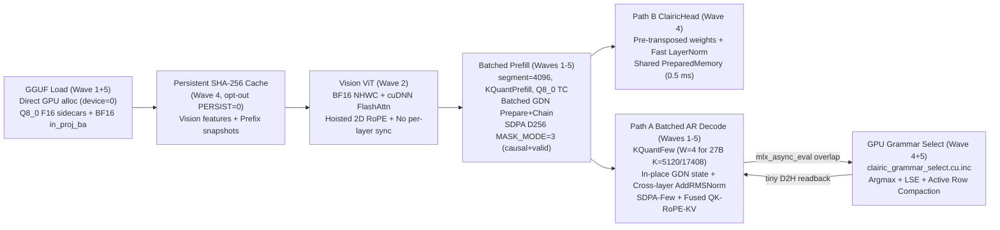

# Clairic (9B Flash & 27B) on Windows/Linux CUDA (`sm_121a`): Engineering Playbook

This document captures the CUDA optimization work for **Clairic Flash (9B)** and **Clairic (27B)** on **NVIDIA RTX Spark N1X** (Windows ARM64 WDDM, CUDA 13.4, `sm_121a`, 48 SMs, 24 MB L2, 102 GB unified LPDDR5X-9400) on branch `feat/cuda-clairic-perf`. macOS Metal paths remain untouched.

---

## 1. Hardware, Models & Silicon Ceilings

| Item | Spec / Measured Ceiling |
| :--- | :--- |
| **GPU** | NVIDIA RTX Spark N1X (`sm_121a`, 48 SMs, 24 MB L2, unified LPDDR5X-9400, WDDM) |
| **Cold DRAM read ceiling** | **`275.8 GB/s`** (`uint4` 128-bit streaming reads at `9400 MHz`) |
| **Thermal clock guard** | Check `nvidia-smi` device 1 (`NVIDIA NPU`) mem clock = **`9400 MHz`** before A/B runs (sustained builds step down to `8533 MHz` = `-10.2%`) |
| **Clairic Flash (9B)** | `Clairic-Flash-UD-Q4_K_XL.gguf` (**5.99 GB**) + `mmproj-BF16.gguf` + `clair_head.safetensors`. 32 layers = 24 GDN (`16k/32v/D=128/W=8192`) + 8 FullAttn (`16q/4kv/D=256`), `H=4096, inter=12288, vocab=248320`, untied `Q6_K` LM head. **Bare DRAM decode weight floor = `21.7 ms/step`** |
| **Clairic (27B)** | `Clairic-UD-Q4_K_XL.gguf` (**16.45 GB**) + `mmproj-BF16.gguf` + `clair_head.safetensors`. 64 layers = 48 GDN (`16k/48v/D=128/W=10240`) + 16 FullAttn (`24q/4kv/D=256`), `H=5120, inter=17408, vocab=248320`, untied `Q6_K` LM head. **Bare DRAM decode weight floor = `59.6 ms/step`** |

---

## 2. End-to-End Progression (Waves 1 -> 5, `9400 MHz`)

Four real structured-extraction workloads:
- **`image-scalar-8`**: 8 scalar fields from `examples/ocr.png` (2 vision passes, 9,088 patches).
- **`image-table-full`**: full document + table rows from `examples/ocr.png`.
- **`text-batch-16`**: invoice with 17 scalar fields + 5 line items (batched `B=16` constrained AR decode).
- **`long-text-3k`**: 3,182-token MSA contract with 13 typed fields (`32,415` chunk prefill tokens).

Both **Uncached** (`MLX_CLAIRIC_PERSIST_CACHE=0`, first-seen document) and **Cached** (`MLX_CLAIRIC_PERSIST_CACHE=1`, repeat document) warm runs are reported below.

### Clairic Flash (9B, `UD-Q4_K_XL`)

| Workload | Baseline Warm | Wave 1 | Wave 2 | Wave 3 | Wave 4 (Uncached / Cached) | **Final Wave 5 (Uncached / Cached)** | Speedup vs Baseline |
| :--- | ---: | ---: | ---: | ---: | ---: | ---: | ---: |
| **`image-scalar-8`** | `30,229.8 ms` | `21,327.6 ms` | `3,282.1 ms` | `3,053.4 ms` | `2,995.8 / 1,566.3 ms` | **`2,836.7 / 1,497.7 ms`** | **10.7× / 20.2×** |
| **`image-table-full`** | `30,891.3 ms` | `24,875.3 ms` | `5,264.4 ms` | `4,934.9 ms` | `4,348.3 / 4,024.9 ms` | **`4,287.5 / 3,899.2 ms`** | **7.2× / 7.9×** |
| **`text-batch-16`** | `32,411.7 ms` *(94.5s cold)* | `23,738.4 ms` | `9,482.9 ms` | `8,797.7 ms` | `8,216.4 / 8,233.8 ms` | **`8,085.9 / 8,181.9 ms`** | **4.0× warm / 11.0× cold** |
| **`long-text-3k`** | `22,005.8 ms` | `21,050.8 ms` | `11,368.0 ms` | `10,541.9 ms` | `10,653.1 / 10,697.5 ms` | **`10,770.0 / 10,837.0 ms`** | **2.04×** |
| **Peak RAM** | `21.6 GB` | `~14.2 GB` | `12.1 GB` | `12.1 GB` | `12.1 GB` | **`10.84 GB`** (`7.69 GB` active) | **-10.76 GB Peak** |

Key phase metrics on 9B:
- **Vision (`9,088` patches)**: `16,000+ ms -> 525.5 ms` (**30.5×**), `0 ms` on repeat document.
- **Batched constrained decode**: **`27.1–27.9 ms/step`** (**78–80%** of bare `21.7 ms` DRAM weight floor).
- **Prefill**: **`3,864–3,911 tok/s`** (`text-batch-16`), **`3,600 tok/s`** (`long-text-3k`).
- **Path B `ClairicHead`**: `8.19 ms -> 0.49–0.70 ms` (**12–17×**).
- **Decode D2H**: `340 ms -> 16–18 ms` (**20×**).
- **End-of-request `clear_cache`**: `1,515 ms -> 0.06 ms`.

### Clairic (27B, `UD-Q4_K_XL`)

| Workload | Baseline Warm | Wave 1 | Wave 2 | Wave 3 | Wave 4 (`8533 MHz` Uncached / Cached) | **Final Wave 5 (`9400 MHz` Uncached / Cached)** | Speedup vs Baseline |
| :--- | ---: | ---: | ---: | ---: | ---: | ---: | ---: |
| **`image-scalar-8`** | `58,807.2 ms` (`75.2 GB`) | `32,695.1 ms` | `8,030.9 ms` | `7,615.0 ms` | `7,490.6 / 4,157.5 ms` | **`7,355.5 / 4,251.2 ms`** | **8.0× / 13.8×** |
| **`text-batch-16`** | **CUDA OOM (`>102 GB`)** | — | `30,872.1 ms` | `28,869.2 ms` | `25,822.9 / 25,974.4 ms` | **`26,518.5 / 26,384.2 ms`** *(25,656 ms cool)* | **Fixed OOM (`24.6 GB` peak)** |
| **`image-table-full`** | — | — | `17,254.4 ms` | `16,041.2 ms` | `13,766.9 / 12,928.2 ms` | **`14,443.5 / 13,573.3 ms`** | `-3.7s` vs Wave 2 |
| **`long-text-3k`** | — | — | `36,773.2 ms` | `33,589.1 ms` | `33,750.1 / 33,957.0 ms` | **`34,045.9 / 33,674.2 ms`** *(33,170 ms cool)* | `-3.1s` vs Wave 2 |
| **Peak RAM** | `>102 GB` (OOM) | `25.8 GB` | `24.9 GB` | `25.1 GB` | `25.1 GB` | **`24.6–24.9 GB`** (`19.0 GB` active) | **-77+ GB vs OOM** |

Key phase metrics on 27B:
- **Batched constrained decode**: **`79.0–82.4 ms/step`** (**72–75%** of bare `59.6 ms` DRAM weight floor across 64 layers + `B=1..16` + 248K `lm_head` + GPU grammar select).
- **Prefill**: **`1,150–1,190 tok/s`**.
- **Accuracy**: 100% deterministic (`cold == warm`), 8/8 exact parity on 27B `image-scalar-8`, 48/49 exact on 9B (only diff is baseline's own table repetition tail on `image-table-full.entries`).

---

## 3. Architecture That Won

### Summary by Wave

1. **Wave 1 — Residency, Batched K-Quant, Graphs Guard**:
   - Guarded `mlx_array_ensure_cuda_device` against `nbytes <= 8` (`SmallSizePool`) and promoted GGUF CPU/tiled repacks straight to `device == 0` (`gguf_gpu.rs`, `gguf_import.rs`), ending Windows WDDM L2 bypass (`device == -1`).
   - Relaxed `x.ndim() < 2` and flattened `M = x.size() / K` in `mlx_kquant_{few,prefill}[_multi]` and `mlx_affine_q4_g64_few_cuda` (eliminated `B > 1` K-quant fallback to BF16 dequant that caused 27B OOM).
   - Added refcounted RAII `CudaGraphsGuard::disable_for_prefill()` (`accelerator.rs`) and `MLX_CLAIRIC_PHASE_TIME=1` timing telemetry.

2. **Wave 2 — Batched GDN + Vision BF16**:
   - Added `mlx_gdn_prepare_batched_cuda` (arbitrary `(Hk, Hv, W)` covering 9B `16/32/8192` and 27B `16/48/10240`, `B >= 1`, optional `valid_lengths`) and generalized `GdnPrefillChainCuda` to `B >= 1` (`0 B` spills).
   - Added `apply_neutral_gdn_mask` (`g=1, beta=0, k=0, v=0` on masked slots) eliminating `gated_delta_ops_serial` (184k intermediate ops on padded 27B batches), and fixed BF16 `g` bailout.
   - Cast vision input to BF16 on CUDA (preserving BF16 through `bilinear_interpolate_gpu` and zero-bias `LayerNorm` to unlock BF16 Tensor Cores + cuDNN FlashAttn on `head_dim=72`), gated per-layer `eval + clear_cache()` on CUDA (`> 32,768` patches unified / `> 8,192` discrete `< 24 GiB`, keeping Metal untouched), hoisted 2D RoPE `(cos, sin)`, added `plan_grid_thw`, and generalized shared media/text prefix caching.

3. **Wave 3 — Masked D256 SDPA, Precise-F32 Norms, Cross-Layer Residual**:
   - Extended `sdpa_tc_few` `MASK_MODE=2` to `[B_m, 1, Q_m, K]` and added `mlx_sdpa_prefill_d256_masked_cuda` (`MASK_MODE=0, 1, 2`, `0 B` spills across all variants).
   - Added `mlx_fused_add_rmsnorm_precise_f32_cuda`, `mlx_rmsnorm_precise_f32_cuda` (lifted `rows > 4096` cap on CUDA), `mlx_qk_norm_rope_kv_store_positions_cuda`, and `mlx_qk_norm_rope_positions_cuda` (`W_IS_F32` exact FP32 norm weights + 2D `[B, T]` positions).
   - Wired decode-only (`B*T <= 16`) cross-layer `LayerResidual::Pending` + `final_norm` fusion.

4. **Wave 4 — GPU Grammar Select, Row Compaction, ClairicHead, Persistent Cache**:
   - Added `clairic_grammar_select.cu.inc` (`39–40` regs, `0 B` spills): fused BF16/F16/F32 logits + optional bitmask + lowest-ID tie-break argmax + `expf`/`double` `log_sum_exp` + `score_token_ids` (cuts decode D2H 20×).
   - Added `select_batch_rows` power-of-2 active-row compaction (`alive * 2 <= B_cur`) in `KVCache` / `ArraysCache` (`-45%` to `-64%` dead decode batch rows).
   - Pre-transposed `ClairicHead` weights in `bake_derived()`, switched to `mlx_fast_layer_norm`, and shared `ClairicPreparedMemory` across `forward_prepared` and `answer_slot_states_prepared` (12–18× faster head).
   - Added content-addressed SHA-256 `ClairicPersistentCache` (`MLX_CLAIRIC_PERSIST_CACHE=0` kill switch, request-local fallback for `> 512 MiB` snapshots) and gated unified CUDA end-of-request `clear_cache()` to >75% memory pressure (`1,515 ms -> 0.06 ms`).

5. **Wave 5 — Silicon-Floor Tuning**:
   - **In-place GDN state (`state_dst == state_in`) in `decode_chunk` only**: dropped `__restrict__` on `state`/`state_out` in `gdn_fused_step.cu.inc`, armed slot 2 exclusively inside `ClairicEngine::decode_chunk` (disarmed before compaction and on exit), skipping `cu::malloc_async` (`-0.77 to -2.30 GB/step` churn and avoiding 24–48 forced `25 MB` CUDA graph splits/step at `B=16`).
   - **Same-stream `mlx_async_eval` grammar overlap**: kicks `[logits, cache...]` onto `default_stream(gpu)` before CPU grammar compile & `fill_batch_allowed_bitmasks_flat`.
   - **CUDA default `segment_tokens = 4096`** (`2048` on `< 24 GiB` discrete GPUs; `1024` unchanged on Metal/CPU), matching `GatedDeltaNet::prepare_batched`'s `4096` ceiling so `B=1` 1.5k–3.4k prompts prefill in 1 pass.
   - **`sdpa_prefill_d256` `MASK_MODE=3`**: explicit `AttentionMask::CausalValid` (`causal & (valid | diag)`) takes `[B, 1, 1, K]` `all_valid` directly via warp `__ballot_sync`, skipping upper-triangle KV tiles (37.5% on seg 0, 46.9% at `Q=1024`) and removing `[B, 1, Q, K]` allocations.
   - **Direct `Q8_0` Tensor-Core prefill + 9B `in_proj_ba` BF16 alignment**: kept `Q8_0` F16 sidecars on CUDA (`persistence.rs`), routed `rows >= 17` through `q8_prefill_cuda` (`gs_shift=-2` exact BF16 MMA `< 128`, `-1` INT8 TC `>= 128`, eliminating ~880 MiB retained BF16 cache on 9B and ~375 MiB on 27B), and aligned 9B's dense F16 `in_proj_ba` weights to BF16 on load (ending 24× FP32 cuBLAS promotions/step).
   - **27B `KQuantFew` warp balance**: routed `tiled && units >= 8 && units % 8 != 0 && units % 4 == 0 && N >= 2048` to `NUM_WARPS=4` (with tightened `__launch_bounds__` keeping 16 warps/SM and `0 B` spills), removing the 33% warp tail imbalance on 27B `K=5120` (`20 units`) and `K=17408` (`68 units`).

---

## 4. Gotchas & Dead Ends (Do Not Repeat)

| Trap | What Happened | Fix / Rule |
| :--- | :--- | :--- |
| **In-place GDN state globally** | `DFlash2` snapshots shallow-alias `cache[1]` (`layer_cache.rs:125-156, 307-321`) — mutating `cache[1]` globally would corrupt speculative rollback | Arm slot 2 **only** inside `ClairicEngine::decode_chunk` where `broadcast_layer_caches` always deep-copies/tiles and `select_batch_rows` disarms first |
| **Lowering `KQuantPrefill` threshold to `rows >= 9`** | `BM=128, BN=64` pads `M=16` by 87.5% and drops CTAs 4× (`64` vs `256` at `N=4096`) | Keep `KQuantFew (M16=true)` for `M in 1..=16`, `KQuantPrefill` for `M >= 17` |
| **Inferring causal+valid from `mask.shape(2) == 1`** | Float additive masks (`0.0`/`-inf`) would coerce to inverted bools on fallback and break non-causal `[B,1,1,K]` masks on Metal/CPU | Always pass explicit `AttentionMask::CausalValid` on an internal helper; never change public `Qwen3_5Attention::forward` semantics |
| **Rust `mask.dtype()?` on boolean masks** | Rust `DType` has no `Bool` variant — calling `.dtype()?` on boolean attention masks fails | Check `ndim`/`shape` in Rust and validate `mask.dtype() == bool_` in C++ |
| **`Q8_0` INT8 TC vs retained BF16 cuBLAS at `M=4096`** | `q8_prefill_cuda` (~100–113 TOPS INT8 TC) is ~100 ms slower than retained cuBLAS BF16 (~135 TFLOPS) on 32k-token `long-text-3k`, while saving 1.37 GB active RAM and 500+ ms cold dequant | Worth keeping for unified memory & cold-start latency; keep `dequant_q8_bf16_cuda` fallback for odd `N` |
| **Local MSVC CRT mismatch with prebuilt `mlx.lib`** | CI prebuilt `mlx.lib` fails with `LNK2019: __std_find_trivial_1` on VS 2022 17.14 | Always build locally with `$env:MLX_PREBUILT = '0'` via `target\windows-tools\build.ps1` |
| **MSVC `C2026` raw string limit (`16,380 B`)** | CRLF line endings push raw `.cu.inc` chunks over 16 KB | Keep every chunk `< 14,500 B` (CRLF-normalized) |
