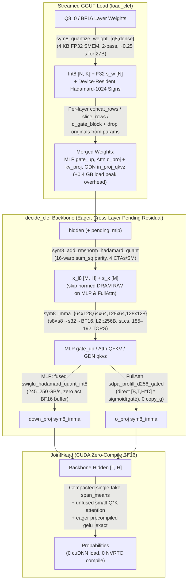

# Clef CUDA Optimization on RTX Spark N1X (`sm_121a`)

End-to-end CUDA optimization of **Clef Flash 9B Q8_0** (`Clef-Flash-Q8_0.gguf`, 9.66 GB, 32L = 24 GDN + 8 FullAttn) and **Clef 27B Q8_0** (`Clef-Q8_0.gguf`, 28.73 GB, 64L = 48 GDN + 16 FullAttn) across Waves 1–3 on NVIDIA RTX Spark N1X (Windows ARM64 WDDM, CUDA 13.4, `sm_121a`, 48 SMs, 24 MB L2, 102 GB LPDDR5X-9400, 269.6 GB/s raw DRAM read ceiling, 73.6 W TDP). All CUDA kernels compile cleanly with **0 B register spills** on `sm_80`–`sm_121a`, and macOS Metal paths remain untouched.

---

## Architecture Overview

---

## Headline Results (RTX Spark N1X, `sm_121a`, 9400 MHz)

Acceptance gate: `< 0.01` max absolute probability error across all 28 probabilities in `__test__/fixtures/clef/acceptance.json` vs `docs/validation/clef-flash-bf16.json` (9B) and `docs/validation/clef-bf16.json` (27B), `allModal == true`, `allExpected == true`, and `cold == warm` deterministic.

### Clef Flash 9B Q8_0 (`Clef-Flash-Q8_0.gguf`)

| Metric / Case (Tokens) | Baseline (Compiled) Cold / Warm | Wave 1 (`NativeQuant`) Cold / Warm | Wave 2 (`Sym8` IMMA) Cold / Warm | **Wave 3 Final** Cold / Warm | Speedup vs Baseline | Max Prob Err |
| :--- | ---: | ---: | ---: | ---: | ---: | ---: |
| **Load / Active / Peak** | `4.42 s` / `20.33` / `21.88 GB` | `4.65 s` / `10.33` / `15.69 GB` | `3.95 s` / `9.52` / `11.08 GB` | **`3.79 s` / `9.49` / `10.91 GB`** | **-11.0 GB Peak (-50%)** | — |
| `invoice` (`258`) | `1,567.6 / 165.9 ms` | `3,969.9 / 97.4 ms` | `375.4 / 71.9 ms` | **`337.5 / 62.3 ms`** (`4,141 tok/s`) | **4.64× / 2.66×** | `0.000838` |
| `outage` (`314`) | `149.1 / 127.8 ms` | `185.9 / 94.2 ms` | `88.6 / 70.4 ms` | **`70.9 / 63.9 ms`** (`4,914 tok/s`) | **2.10× / 2.00×** | `0.000978` |
| `routine` (`340`) | `141.3 / 131.3 ms` | `161.9 / 94.6 ms` | `79.6 / 74.4 ms` | **`84.8 / 67.5 ms`** (`5,037 tok/s`) | **1.67× / 1.95×** | `0.000298` |
| `unicode` (`243`) | `154.7 / 130.0 ms` | `148.0 / 87.7 ms` | `65.4 / 62.5 ms` | **`60.9 / 60.7 ms`** (`4,003 tok/s`) | **2.54× / 2.14×** | `0.000515` |
| `single-option` (`120`) | `127.1 / 116.0 ms` | `95.4 / 69.2 ms` | `68.1 / 60.4 ms` | **`65.7 / 51.6 ms`** (`2,326 tok/s`) | **1.93× / 2.25×** | `0.000000` |
| `long-context` (`2,960`) | `775.3 / 759.7 ms` | `785.8 / 717.1 ms` | `493.1 / 450.5 ms` | **`438.8 / 412.6 ms`** (`7,174 tok/s`) | **1.77× / 1.84×** | `0.000299` |
| **SUM 6 Cases** | `2,915.1 / 1,430.7 ms` | `5,346.9 / 1,160.2 ms` | `1,170.2 / 790.1 ms` | **`1,058.6 / 718.6 ms`** | **2.75× / 1.99×** *(1.59× vs M5 Max `1.14 s`)* | **`0.000978` PASS** |
| `stress_6k` (`5,688`) | `8,626.5 / 1,764.3 ms` | `1,475.5 / 1,417.3 ms` | `927.8 / 874.3 ms` | **`819.0 / 777.2 ms`** (`7,319 tok/s`) | **10.53× / 2.27×** | `det=true` |

### Clef 27B Q8_0 (`Clef-Q8_0.gguf`)

| Metric / Case (Tokens) | Baseline (Compiled) Cold / Warm | Wave 1 (`NativeQuant`) Cold / Warm | Wave 2 (`Sym8` IMMA) Cold / Warm | **Wave 3 Final** Cold / Warm | Speedup vs Baseline | Max Prob Err |
| :--- | ---: | ---: | ---: | ---: | ---: | ---: |
| **Load / Active / Peak** | `69.98 s` / `63.06` / `65.21 GB` | `13.54 s` / `31.06` / `49.75 GB` | `11.99 s` / `27.77` / `29.48 GB` | **`11.15 s` / `27.72` / `29.72 GB`** | **6.28× Load / -35.5 GB Peak** | — |
| `invoice` (`258`) | `6,354.0 / 371.1 ms` | `832.9 / 292.7 ms` | `575.3 / 209.0 ms` | **`524.3 / 206.5 ms`** (`1,249 tok/s`) | **12.12× / 1.80×** | `0.000243` |
| `outage` (`314`) | `385.0 / 361.4 ms` | `413.3 / 304.0 ms` | `259.4 / 224.9 ms` | **`260.0 / 215.0 ms`** (`1,461 tok/s`) | **1.48× / 1.68×** | `0.002496` |
| `routine` (`340`) | `387.3 / 369.3 ms` | `377.1 / 310.3 ms` | `264.7 / 249.5 ms` | **`243.9 / 221.3 ms`** (`1,536 tok/s`) | **1.59× / 1.67×** | `0.000338` |
| `unicode` (`243`) | `382.2 / 352.4 ms` | `324.4 / 248.8 ms` | `202.7 / 202.6 ms` | **`199.3 / 198.8 ms`** (`1,222 tok/s`) | **1.92× / 1.77×** | `0.000422` |
| `single-option` (`120`) | `359.5 / 334.9 ms` | `237.3 / 218.2 ms` | `193.1 / 169.4 ms` | **`189.6 / 175.7 ms`** (`683 tok/s`) | **1.90× / 1.91×** | `0.000000` |
| `long-context` (`2,960`) | `2,134.8 / 2,321.7 ms` | `2,451.4 / 2,468.2 ms` | `1,589.8 / 1,439.7 ms` | **`1,533.1 / 1,356.2 ms`** (`2,183 tok/s`) | **1.39× / 1.71×** | `0.000163` |
| **SUM 6 Cases** | `10,002.8 / 4,110.8 ms` | `4,636.4 / 3,842.2 ms` | `3,085.0 / 2,495.1 ms` | **`2,950.2 / 2,373.5 ms`** | **3.39× / 1.73×** | **`0.002496` PASS** |
| `stress_6k` (`5,688`) | `8,801.4 / 6,170.0 ms` | `4,755.5 / 4,639.1 ms` | `3,040.1 / 2,769.8 ms` | **`2,984.7 / 2,564.5 ms`** (`2,218 tok/s`) | **2.95× / 2.41×** | `det=true` |

### Clef 27B Q4_K_M (`Clef-Q4_K_M.gguf`, 18.19 GiB)

Tensor mix: 364 `Q8_0` (Attention/GDN/`lm_head`/`clef_head`), 193 `Q4_K` (all 64 MLP units = 192 tensors + `token_embd`), 453 `F32`, 1 `BF16`.

| Metric / Case (Tokens) | `CLEF_RESIDENCY=native` (`KQuantPrefill`) Cold / Warm | Pre-Fusion `Sym8` (`Tiled64` untile + scalar dequant) Cold / Warm | **Fused `Q4_K -> Sym8`** Cold / Warm | Speedup vs Native / Pre-Fusion | Max Prob Err |
| :--- | ---: | ---: | ---: | ---: | ---: |
| **Load (page-cached) / Active / Peak** | `7.27 s` / `20.80` / `20.92 GB` | `11.88 s` / `27.42` / `28.41 GB` | **`9.08 s` / `27.08` / `27.54 GB`** | **-2.80 s Load (-24%) / -0.87 GB Load Peak** | — |
| `invoice` (`258`) | `2,252.9 / 303.3 ms` | `1,227.6 / 196.5 ms` | **`1,223.6 / 201.2 ms`** (`1,282 tok/s`) | **1.51×** warm vs native | `0.000665` |
| `outage` (`314`) | `340.1 / 311.8 ms` | `324.9 / 203.7 ms` | **`231.3 / 206.4 ms`** (`1,521 tok/s`) | **1.51×** warm vs native | `0.010387` *(native `0.010409`)* |
| `routine` (`340`) | `334.0 / 315.3 ms` | `349.7 / 215.5 ms` | **`242.9 / 216.6 ms`** (`1,570 tok/s`) | **1.46×** warm vs native | `0.001470` |
| `unicode` (`243`) | `231.3 / 230.7 ms` | `197.7 / 191.5 ms` | **`196.9 / 187.9 ms`** (`1,293 tok/s`) | **1.23×** warm vs native | `0.000196` |
| `single-option` (`120`) | `472.1 / 153.0 ms` | `267.0 / 164.8 ms` | **`204.3 / 161.1 ms`** (`745 tok/s`) | `0.95×` warm vs native | `0.000000` |
| `long-context` (`2,960`) | `2,603.8 / 2,453.1 ms` | `2,435.6 / 1,387.8 ms` | **`1,501.1 / 1,368.4 ms`** (`2,163 tok/s`) | **1.79×** warm vs native | `0.000076` |
| **SUM 6 Cases** | `6,234.2 / 3,767.2 ms` | `4,802.5 / 2,359.8 ms` | **`3,600.1 / 2,341.6 ms`** | **1.61× warm vs native / -1.20 s cold** | `allModal/Exp/Det=true` |
| `stress_6k` (`5,688`) | `4,983.0 / 4,802.2 ms` | `4,441.5 / 2,667.2 ms` | **`3,309.0 / 2,625.5 ms`** (`2,166 tok/s`) | **1.83×** warm vs native (`peak 29.07 GB`) | `det=true` |

> On discrete 24 GB CUDA GPUs (`21 GiB` VRAM budget), `DiscreteGpuMemoryFit` automatically selects `NativeQuant` (`19.37 GiB <= 21 GiB`, 100% VRAM-resident via `KQuantPrefill` with zero PCIe spill) when `CLEF_RESIDENCY` is unset, while unified-memory hosts (RTX Spark) and 32+ GB GPUs run full `Sym8` (`2,166 tok/s`).

---

## Silicon Roofline & Key Changes

### Why `Sym8` Fused-Epilogue IMMA Won Over Both BF16 cuBLAS and `Q8_0` Direct Prefill
- Measured on `sm_121a` (cold-L2 median, full-entropy random INT8):
  - Tuned BF16 cuBLAS: **92–106 TFLOPS** (heuristic `#0` only ~65 TFLOPS).
  - Direct `Q8_0` `qwen4_q8_prefill_int8_128x128`: **90–102 TOPS** (per-32 scale reset zeroes INT32 accumulators every `m16n8k32` MMA; unrotated `GS=256` INT8 activation quant drifted 27B `outage` to `0.0195` FAIL).
  - `cuBLASLt INT8 -> INT32`: **183–201 TOPS**, but separate `int32 -> bf16` rescale spills `792 MB` out of 24 MB L2 at `M=5688, N=34816` (`+4.6 ms`).
  - **Custom fused-epilogue `sym8_imma` (`s8 × s8 -> s32 -> BF16`)**: **185–192 TOPS**, **0 B `int32` scratch**, **0 B spills** on `sm_80`–`sm_121a`, exact match to proven `ClefResidency::Sym8` + Hadamard-1024 (`100%` of 9B/27B Sym8 widths are multiples of 1024).

### Wave-by-Wave Summary
- **Wave 1 (Residency & Eager Hygiene)**: Fixed silent `Float16` compute dtype on Clef (`BFloat16`), kept Q8_0 embeddings packed, skipped `decide_backbone_compiled` NVRTC spikes on CUDA (`CudaGraphsGuard::disable_for_prefill()`), unified GGUF `JointHead` to BF16 with pre-transposed weights, lifted GDN batched cap to `65536`.
- **Wave 2 (`Sym8` IMMA Kernel Suite + `JointHead` Zero-Compile + Load Peak Fix)**:
  - Landed `crates/mlx-sys/src/cuda/sym8/` (`sym8_hadamard`, `sym8_weight_quant`, `sym8_imma_large`, `sym8_imma_small`, `sym8_cuda.cpp`) and `crates/mlx-core/src/kernels/sym8.rs` gated on `accelerator::cuda_sym8_available()` (`sm >= 8.0`).
  - Allowed CUDA `Sym8` `concat_rows`, `slice_rows`, and `finalize_packed_q_gate_block`, enabling merged `gate_up`, `kv_proj`, fused MLP `swiglu_hadamard_quant_int8` (`245–250 GB/s`), and shared attention input quant.
  - Replaced `JointHead` cuDNN SDPA (`3.59 s` first-call + `70–157 ms` per new `T`) with unfused small-`Q*K` precompiled attention and eager `gelu_exact`.
  - Released replaced source keys per layer in `apply_weights_inner_with_residency` (`49.75 GB -> 28.15 GB` 27B load peak; also cut Clairic 9B peak `10.84 -> 9.01 GB`).
  - Threaded `LayerResidual` across `decide_clef`, removed double final sync, and cached detached GDN zero-states.
- **Wave 3 (Silicon-Floor Accounting & Fusion)**:
  - **P0**: Promoted Hadamard `signs` to CUDA device memory via `ensure_cuda_device()` (eliminating WDDM pinned-host L2 bypass: `-155 ms` on 27B `stress_6k`).
  - **P1**: Fused `[B, T, H*D]` + `sigmoid(gate)` epilogue into `sdpa_prefill_d256_gated` (`0` bit mismatches, `+0` regs, eliminates MLX `copy_g` + `sigmoid_mul`; also sped up Clairic 9B `1,500 -> 1,478 ms`).
  - **P3**: Fused `Add + RMSNorm + Hadamard-1024 + INT8 Quant` (`sym8_rmsnorm_hadamard.cu.inc`, 16-warp `sum_sq` parity matching `add_rmsnorm.cu.inc` bit-for-bit) across MLP, FullAttn (`write_normed=false`), and GDN (`write_normed=true`).
  - **P4**: Fixed small-`M` L2 thrashing (`st.global.cs.v4.u32`, `cp.async.ca` on small `A`, `L2::256B` on `B`, `sym8_imma_128x64_k128_s3`, `128x128_k128_s3_gm8` for `M >= 280, N >= 16384`: `-39%` on 27B `M=340` `gate_up`).
  - **P5**: Replaced full `[T, H]` FP32 `span_cumsum` in `JointHead` with single-`take` compacted span-slice means.
- **Wave 4 (`Clef-Q4_K_M` & K-Quant CUDA Path)**:
  - Added CUDA `Q6_K` GGUF repack kernels (`gguf_repack_q6k.cu.inc`, `RowMajor` & `Tiled64`, 36–40 regs, 0 B spills, tail-read safe) in `mlx_gguf_repack_cuda.cpp` and `gguf_gpu.rs`.
  - Added fused `sym8_quantize_weight_kquant` (`sym8_weight_quant_kquant.cu.inc`, `Q4_K` & `Q6_K`, `RowMajor` & `Tiled64` direct in registers -> FP32 FWHT-1024 -> `Sym8`, 34–48 regs, 0 B spills), eliminating `Tiled64 -> RowMajor` GPU untile copies and `~510 MiB`/MLP BF16 scratch during `Clef-Q4_K_M` load (`11.88 s -> 9.08 s` warm load, `28.41 -> 27.54 GB` load peak, matching `Clef-Q8_0` `2,166 tok/s` warm throughput).
  - Added post-Sym8 GDN `in_proj_qkv` + `in_proj_z` merge in `apply_weights_inner_with_residency` so mixed-qtype GDN checkpoints still unlock fused `Add+RMSNorm+HadQuant`.
  - Added `DiscreteGpuMemoryFit` auto-residency on discrete CUDA GPUs so K-quant checkpoints that fit VRAM natively (`Clef-Q4_K_M` `19.37 GiB` on a 24 GB GPU) stay 100% VRAM-resident under `NativeQuant` instead of expanding past the VRAM budget and spilling over PCIe.
- **Hardening**: Fixed all 9 adversarial review findings (process-wide mutex + static-SMEM-aware `ensure_dynamic_smem`, `NaN`/`Inf` propagation, `eps < 0` / zero-row guards, `grid_x` overflow checks, `cuda_sym8_available()` `sm >= 8.0` gate, fail-loud missing affine `.biases`, and `block_size == 1024` validation).
