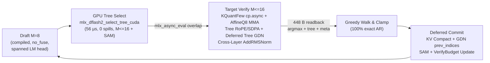

# Qwen3.8-27B + DFlash2 on Windows ARM64 CUDA (`sm_121a`): Engineering Playbook & Lessons Learned

This document records everything learned while optimizing **Qwen3.8-27B dense GGUF (`UD-Q4_K_XL`) + DFlash2** in `mlx-node` on an **NVIDIA RTX Spark N1X** (Windows ARM64, CUDA 13.4, `sm_121a`, unified LPDDR5X) across PR #392 (`feat/cuda-qwen38-tree-verify-perf` + `mlx-node/mlx@c1aec005`).

It captures exact hardware measurements, kernel/runtime architecture, **dead ends we hit and why they lost**, permanent Windows/CUDA/MSVC reliability fixes, and open headroom.

---

## 1. Hardware, Workload & True Silicon Ceilings

| Item | Verified Spec / Measurement |
| :--- | :--- |
| **Device** | NVIDIA RTX Spark N1X (`sm_121a`, Blackwell, 48 SMs, 24 MB L2, 102 GB unified LPDDR5X-9400, Windows ARM64 WDDM, CUDA 13.4) |
| **Theoretical pin bandwidth** | `300.8 GB/s` (LPDDR5X-9400) |
| **Measured cold-DRAM read ceiling** | **`275.8–276.0 GB/s`** median (`281.1 GB/s` peak) on 512 MB buffer; `265.1 GB/s` median on 1 GB buffer (`uint4` 128-bit streaming reads) |
| **Measured copy (R+W) ceiling** | `224.9 GB/s` (custom kernel) / `244.3 GB/s` (`cudaMemcpy`) |
| **Thermal clock trap (CRITICAL)** | On RTX Spark N1X, `nvidia-smi` **device 1 (`NVIDIA NPU`)** reports the unified LPDDR5X memory clock. After heavy 20-core native builds or sustained load, LPDDR5X steps down from **`9400 MHz` -> `8533 MHz` (`-10.2%`)** while GPU core temp looks mild (~59°C). **Always check mem clock = `9400 MHz` before comparing A/B runs.** |
| **Target model** | `Qwen3.8-27B-UD-Q4_K_XL.gguf` — **64 layers** = 48 GDN (`Hk=16, Hv=48, Dk=Dv=128, conv=4`) + 16 FullAttn (`Hq=24, Hkv=4, GQA=6, D=256`), `hidden=5120`, `inter=17408`, `vocab=248320`. Active decode weights = **`16,887 MB`** (`51% Q5_K`, `23% IQ4_XS`, `15% Q6_K`, `7% Q4_K`, `1.2% Q8_0`) — ~7% heavier than `UD-Q4_K_M` (`~15.6 GB`) used by Splash. |
| **Draft model** | `Qwen3.8-27B-DFlash2` — 5 layers, `Hkv=8, D=128`, taps from target layers `5/19/33/47/61`, ring window `2048`, `L=7` draft slots (`M=8` block), shared target embedding & spanned LM head, Markov `CandidateSelector` (`[L, 16, 16]` transition lattice). |
| **Theoretical cycle floor** | Pure target weights alone at `275.8 GB/s` = `16,887 MB / 275.8 GB/s = 61.2 ms`. Adding 16L KV at 6k (`407 MB -> 1.7 ms`), 48L GDN state (`~300–400 MB -> 1.7 ms`), draft `M=8` (`~1.0 GB -> ~4–5 ms`), and graph/norm/elementwise overhead puts practical silicon floor near **`~85–92 ms/cycle`**. |

---

## 2. End-to-End Progression & Final Benchmarks

All runs use `MLX_CUDA_USE_CUDNN_SDPA=0`, greedy decoding, frozen prompts (`6k`: 6,219 input tokens; `1k`: 1,162 input tokens; `coding`: ~400-token Rust/TS refactor prompt).

| Workload | Baseline (`HEAD 73a06137`) | Wave A (`TREE=0`, `M=8`) | **Wave B (`TREE=1` GPU, `M=16`)** | Gain vs `TREE=0` | Text Parity |
| :--- | ---: | ---: | ---: | ---: | :--- |
| **`6k / 16t`** Prefill | `947.4 tok/s` (`6564 ms`) | `1,095–1,131 tok/s` (`5565 ms`) | `1,086 tok/s` | — *(+15% vs HEAD)* | Exact |
| **`6k / 16t`** Decode | `25.28 tok/s` (`118–120 ms/c`) | `29.37–32.80 tok/s` (`3.00 t/c`, `5 cyc`) | **`46.96 tok/s`** (`5.00 t/c`, `3 cyc`) | **+59.9%** *(+85.8% vs HEAD)* | **100% exact** (frozen 62/62 B) |
| **`6k / 256t`** Decode | — | `41.13–45.58 tok/s` (`4.18 t/c`, `61 cyc`) | **`49.80 tok/s`** (`5.20 t/c`, `49 cyc`) | **+21.1%** | **100% exact** (980/980 B) |
| **`1k / 256t`** Decode | — | `52.24–57.91 tok/s` (`5.17 t/c`, `6 cyc`) | **`60.95 tok/s`** (`6.20 t/c`, `5 cyc`) | **+16.7%** | **100% exact** (152/152 B) |
| **`coding / 256t`** Decode | — | `75.53 tok/s` (`7.08 t/c`, `36 cyc`) | **`96.69 tok/s`** (`9.44 t/c`, `27 cyc`) | **+28.0%** | **100% exact** (843/843 B) |
| **Active / Peak RAM** | `68.60 / 74.26 GB` | `20.24 / 22.00 GB` | **`20.24 / 22.00 GB`** | **-52.26 GB Peak** vs HEAD | — |

*(Cool-chip `TREE=0` runs at `91.5 ms/c` @ 6k / `86.4 ms/c` @ 1k; back-to-back matched-thermal runs sit ~8–9 ms warmer across both modes, where `M=8 -> M=16` GPU tree adds only **`+2.85 ms/cyc` (+2.8%)**.)*

---

## 3. Architecture That Won

### 3.1 Why Memory Dropped `-52.26 GB` AND Prefill Got `+15%` Faster
1. **Eliminated BF16 retained prefill weight cache (`-48.4 GB` RAM)**: Previously, prefill dequantized GGUF weights into a persistent BF16 cache (`68.6 GB` active / `74.3 GB` peak). Replacing it with fused K-quant prefill Tensor Core MMA (`crates/mlx-sys/src/cuda/kquant_prefill.cu.inc`), FlashAttention-2 `D=256` prefill (`sdpa_prefill_d256.cu.inc`), and fused GDN prefill chain (`gdn_prefill_chain.cu.inc`) dropped memory to **`20.24 / 22.00 GB`** while speeding up 6k prefill from `6564 ms -> 5565 ms`.
2. **Zero-copy 2D-strided `SwiGLU` / `SigmoidMul` (`-150–200 ms` prefill)**: Merged `gate_up` splits produce strided `[1, 3110, 17408]` views. `FusedGateBinaryCuda` was calling `cu::contiguous_inputs()`, copying `2 x 108 MB` per merged layer (`395 ms` wasted in `6k` prefill!). Adding zero-copy strided kernels in `crates/mlx-sys/src/cuda/add_rmsnorm.cu.inc` + `crates/mlx-sys/src/mlx_fused_ops.cpp` eliminated the copy completely (`27 regs, 0 spills`).
3. **Separate WDDM pinned host buffer pool (`mlx/backend/cuda/allocator.cpp`)**: On Windows WDDM without concurrent managed memory, keeping `device == -1` host buffers in `host_buffer_cache_` prevents GPU ops from reusing pinned host memory and stops stale D2H copies.

### 3.2 Why Decode Cycle Time Dropped From `119 ms` -> `~88–94 ms` (Wave A)
1. **MLX CUDA Graph & cuBLASLt overhead (`mlx-node/mlx@c1aec005`)**:
   - **cuBLASLt plan & captured-subgraph cache (`cublas_utils.cpp`, `device.cpp`)**: Cached `cublasLtMatmulAlgoGetHeuristic` + `subgraph_to_key()` per `(plan_key, ptr_align_bucket)`.
   - **`sm_121` graph limit (`device.cpp`)**: Raised `ops` from `20 -> 100` while keeping **`mb = 25`** (see Section 4 for why raising `mb` hurts!).
   - **`malloc_async` accounting (`allocator.cpp`, `device.h`)**: Tracked `bytes_in_graph_` on allocations (`add_graph_bytes`) instead of `set_input_array` so read-only weights don't artificially trip graph flushes.
2. **Unified 128-bit `cp.async.cg` SMEM streaming in `KQuantFew` (`kquant_few.cu.inc`)**:
   - 2-stage double-buffered `cp.async.cg.shared.global` (`W=8` for `units >= 8`, `W=4` for `units < 8`) supporting BOTH `M <= 8` (`M16=false`) and `M in 9..=16` (`M16=true`), 0 register spills on `M <= 8`, `<= 8 KB` SMEM, reaching **`262–268 GB/s`** (~96% of cold DRAM ceiling!) across all 380 K-quant ops.
   - Multi-output `KQuantFewMulti` fuses `qkv` / `gate_up` input quantization once (`-0.42 ms/cyc`).
3. **Deferred 48L GDN state fold (`gdn_fused_step.cu.inc`, `layer_cache.rs`)**:
   - Instead of replaying the accepted prefix in a separate pass after verify (writing 48L × `[48, 128, 128]` FP32 states twice = `~302 MB` extra DRAM traffic), verify folds the *previous* cycle's accepted `(q, k, v, g, beta)` into `S_folded` right inside the vectorized `float4` GDN verify kernel and fuses `RMSNormGated(y, z, norm_weight, eps)` in registers (`4.04 ms -> 1.66 ms` standalone; `-1.45 to -2.13 ms/cyc` end-to-end).
   - `settle_flat_dflash2_deferred` folds the final pending slice on turn finish/drop so subsequent turns or AR fallback see exact settled state.
4. **Decode-only cross-layer `AddRMSNorm` (`add_rmsnorm.cu.inc`, `decoder_layer.rs`, `model/forward.rs`)**:
   - Fuses `residual + delta` with the next layer's `RMSNorm` (`-2.51 ms/cyc` on `6k/256t`), gated to `seq_len <= 16` so prefill never holds an extra `[chunk_rows, 5120]` tensor alive (`-30.4 MB` peak RAM).
   - Unrolled `uint4 h0, h1` removed a 32-byte local stack spill (`40 regs, 0 B spills`).
5. **Fused `QkNormRopeKvStoreCuda` (`qk_norm_rope_kv.cu.inc`)**: Fuses Q/K RMSNorm + partial RoPE + in-place KV cache write (`-1.20 ms/cyc`).
6. **`SDPA-Few` (`sdpa_tc_few.cu.inc`)**: `cp.async.cg`, `ex2.approx`, BF16 `partial_O`, `max_splits=8` at `Hkv=4`, single-KV-pass up to `M <= 96` (`gqa=6 × Q=16 = 96` reads the 6k KV cache only **ONCE**!), saving `-0.57 ms/cyc` at `Q=8` and adding only `+0.13 ms` at `Q=16`.
7. **Draft `AffineQ4G64Few` (`affine_q4_few.cu.inc`) + Spanned LM head + Async Propose Overlap**: Keeps the 5-layer `M=8` draft fast and overlapped with target CPU graph construction via `mlx_async_eval`.

### 3.3 Why Speculative Tree Verification + Suffix-Automaton Lookup Unlocks 50–97 tok/s (Wave B)
Once decode is memory-bandwidth-bound at ~95% of DRAM ceiling, **increasing verified tokens per weight pass (`M = 8 -> 16`) is almost free**:
- Measured GPU delta to double verification width from `M=8 -> M=16` across the entire 27B model:
  - `KQuantFew` (380 ops): `+1.24 ms`
  - `AffineQ8Few` (83 ops): `+0.04 ms`
  - `Tree GDN` (48 layers, Splash backward query pullback + gather-free `prev_indices`): `+0.03 ms`
  - `Tree SDPA` (16 layers, `M=96` single KV pass): `+0.13 ms`
  - Total end-to-end with GPU tree selector: **`+2.85 ms/cyc` (+2.8%)** for **`+24% to +33%`** more accepted tokens per cycle!
- **Key insight from DFlash2's `CandidateSelector`**: DFlash2 already computes the exact `[L, 16, 16]` Markov transition lattice `(candidates, scores)` consumed by Splash's `draft_select_tree` — keeping the draft model fixed at `M=8` (`L=7`, compiled graph never retraces!).
- **Zero-sync GPU tree selection (`dflash2_select_tree.cu.inc`, `55.68 µs`, 40 regs, 0 spills)**:
  - CPU `build_verify_tree` forced a host readback of `(candidates, scores)` between draft and target, breaking `async_eval` overlap and exposing a **`+5.6 to +6.2 ms/cyc`** bubble!
  - Moving `build_verify_tree` onto GPU (passing tiny CPU-computed `lookup_tokens [16]`, `lookup_rates [16, 4]`, `budget_intercepts [8]` with zero GPU sync) keeps `draft -> select_tree_cuda -> target_verify -> argmax` in **one unbroken async GPU stream**, reading back only **448 bytes** (`argmax + tree_tokens + parent + packed node_meta`) once per cycle.
  - **DFS preorder (highest-probability child first)** guarantees `0 <= parent[i] < i` (single-pass topological order for GDN pullback & SDPA mask) AND makes the likeliest path contiguous `[0, 1, ..., d]` so KV trim / conv slice / tap slice hit the zero-copy fast path on most cycles.
- **Exact non-contiguous branch commits (100% bit-exact AR)**:
  - FullAttn: single-launch register-staged `mlx_kv_compact_rows_cuda` (race-free in-place compaction; **must reassign returned aliased `(new_k, new_v)` handles** to preserve MLX graph ordering!).
  - GDN: stores one shared `prev_indices: Option<MxArray>` (`int32[keep]`) in `CudaPendingGdn` so the next cycle's `mlx_gdn_tree_step_cuda` folds the non-contiguous branch gather-free (and linear chain cycles after a non-contiguous branch automatically route through `tree_step_deferred` with chain parent `[-1, 0, ..., T-2]`).
  - `prepare_tree` conv state: `mlx_gdn_prepare_tree_cuda` writes linear trailing 3 rows to `outputs[5]`, so `commit_tree_dflash2_deferred` skips `replay_conv_tree_into` **only** when `is_chain && is_contiguous_prefix && keep == window_len`; otherwise it rebuilds `cache[0]` from `snapshot_conv` + the last `min(3, keep)` accepted rows of `tape.qkv`.
  - Stop/EOS clamping: `dspark_turn.rs` runs `clamp_dspark_cycle` on `emitted_tokens` **before** `commit_tree`, committing only `&accepted_nodes[..kept_len]` and recomputing `is_contiguous_prefix` on the truncated slice.

---

## 4. Dead Ends & Counter-Intuitive Findings (Do NOT Repeat These!)

| Experiment | Expected | Measured Reality on RTX Spark N1X (`sm_121a`) | Root Cause & Verdict |
| :--- | :--- | :--- | :--- |
| **Replacing `cp.async.cg` with scalar `ld.global.cs.u16`/`u32` (+ `W=16`) in `KQuantFew`** | Faster cold DRAM streaming | **Regressed `+5.5 to +6.0 ms/cyc`** end-to-end (`94.4 -> 100.4 ms/c`) despite looking faster in an isolated synthetic loop | Unaligned overlapping 32-bit loads on `Q5_K`/`Q6_K`, zero 2-stage software pipelining, and L1/TEX thrashing across 64-layer CUDA Graphs. **Reverted to unified 128-bit `cp.async.cg` (`W=8`) for both `M<=8` and `M<=16`.** |
| **Blackwell `v8.u32` (256-bit) loads** | Higher LPDDR5X utilization | **Slower than `uint4` (`271.6` vs `275.8 GB/s`)** and `-10 to -20 GB/s` inside `KQuantFew` | Wider 256-bit transactions hurt occupancy & coalescing on 48-SM unified LPDDR5X. **Stick to 128-bit `uint4` / `cp.async.cg`.** |
| **Blackwell PDL (Programmatic Dependent Launch)** | Hide inter-kernel launch gaps | **Net slower / unstable** in MLX CUDA Graphs | Graph replay overhead + cross-kernel sync stalls outweighed tail overlap. **Reverted completely.** |
| **Split-K on `AffineQ8Few`** | Better SM occupancy on small `N` | **Regressed `+0.35 to +0.78 ms` standalone** (`2.262` vs `1.911 ms` @ `M=8`; `2.806` vs `2.031 ms` @ `M=16`) | 48 extra `malloc_async` partial buffers + 48 reduce launches inflated `bytes_in_graph_` & graph commits. **Use single-launch `u4_1row` (`M<=8`) and single-launch `mma<SB,2,false>` (`M in 9..=16`).** |
| **Exact-FP32 `u4_1row` at `M=16` as default** | Match `M=8` tie-breaks at same speed | **FP32-ALU-bound: `+1.66 ms` slower** (`3.530` vs `1.870 ms` for `mma`) | Unsigned 8-bit ints `0..255` are **exact in BF16** (8-bit mantissa), so BF16 `mma` has zero weight rounding error — any 1-ULP difference vs `u4_1row` is pure FP32 summation order. **Keep `mma` default; expose `MLX_CUDA_AQ8_EXACT_M16=1` for bit-exact parity checks.** |
| **Raising `MLX_MAX_MB_PER_BUFFER` (`25 -> 512/2000`)** | Fewer graph commits = faster | **Regressed `+4.0 ms/cyc` AND `+5.6 GB` peak RAM** | `mb=25` naturally pipelines CPU graph encoding with GPU execution and recycles transient allocations quickly; huge buffers serialize CPU build before first GPU launch. **Keep default `mb=25`.** |
| **Cross-layer `AddRMSNorm` during prefill** | Fewer prefill launches | **Added `+30.4 MB` peak RAM** (`22.003 -> 22.034 GB`) and slowed 6k prefill | Held an extra `[3110, 5120]` BF16 residual tensor alive across layers, triggering extra 25 MB graph flushes. **Gate strictly to `seq_len <= 16` decode/verify.** |
| **`SDPA-Few` `max_splits = 12` (48 CTAs = 1 full wave) vs `8` (32 CTAs)** | Better SM utilization at `K=6220` | **Regressed `+2.09 ms/cyc` end-to-end** (`102.50` vs `100.41 ms`) | Larger `partial_o/m/l` temporary allocations + heavier split-K reduction & `bytes_in_graph_` pressure. **Keep `max_splits = 8` for `Hkv = 4`.** |
| **Unmodified Splash `LookupAcceptance::PRIOR` on 6k prose prompts** | Higher tok/cyc everywhere | **Regressed `6k/256t` from `5.10–5.31` -> `4.90 tok/cyc`** (`52` vs `48–50` cycles) while boosting `1k` (`5.17 -> 6.20`) | Short false-positive matches (`match_len 4–12`) still got `0.56–0.79` prior at depths `2..7` and `0.85–0.93` at `Unknown` depths `7..14`; `left = 1.0 - reserved` crushed DFlash2's own top-1 branch to `<= 0.22` and filled 8–11 of 15 tree slots with dead lookup nodes. **Fix**: on short matches (`rate(d=0, Absent) < 0.40`, i.e., `match_len < 32`), cap `Candidate`/`Absent` chain rates by depth-0 prior and stop extending past an `Absent` disagreement — **lifted `6k/16t` `3.75 -> 5.00 t/c` (`46.96 tok/s`) and `6k/256t` `4.90 -> 5.20 t/c` (`49.80 tok/s`) while keeping `coding/256t` at `9.44 t/c` (`96.69 tok/s`)!** |
| **CPU `build_verify_tree` between GPU draft and target** | Negligible (`0.15 ms` CPU compute) | **Added `+5.62 to +6.2 ms/cyc`** (`91.7 -> 97.9 ms/c` even at `T=8`) | Host sync to read 7.6 KB lattice drained the GPU queue and exposed the `~2.5 ms` CPU target graph build bubble. **Fixed by `mlx_dflash2_select_tree_cuda`.** |

---

## 5. Windows ARM64 / CUDA / MSVC / Cross-Platform Survival Guide

### 5.1 Permanent Fix for the Random Hang (`get_jit_module` `SRWLOCK` Deadlock)
- **Symptom**: Process freezes indefinitely at 0% GPU / 0% CPU during kernel JIT load.
- **Root cause**: `mlx.lib` on Windows was compiled **without `/EHsc`** (`X=0` in ARM64 `.xdata` unwind tables). Any C++ exception thrown inside `get_jit_module()` (e.g., missing `nvrtc-builtins*.dll` or missing `C:\Program Files\NVIDIA GPU Computing Toolkit\CUDA`) skipped `std::unique_lock::~unique_lock()`, leaving `std::shared_mutex` permanently locked (`*mtx = 1`) for the next thread.
- **4-part permanent fix**:
  1. `crates/mlx-sys/build.rs`: Pass `cfg.cxxflag("/EHsc")` on Windows MSVC builds of MLX from source.
  2. `mlx/backend/cuda/delayload.cpp`: Resolve relative `MLX_CUDA_BIN_DIR` (`.`) against `current_binary_dir()` and preload `nvrtc-builtins*.dll` before NVRTC loads.
  3. `mlx/backend/cuda/jit_module.cpp`: Guard `default_cuda_toolkit_path()` with `fs::exists(..., ec)` so missing toolkit directories never throw.
  4. `mlx/backend/cuda/jit_module.cpp` + `crates/mlx-sys/src/mlx_cuda_ops.h`: Sanitize Windows-illegal filename characters (`< > : " / \ | ? *`) in PTX cache paths and templated kernel module names (`mlx_node_kquant_matmul_few<...>` -> valid `.ptx` cache files on disk).

### 5.2 MSVC & Build Gotchas
- **MSVC `C2026: string too big`**: String literals in `.cu.inc` > 16,380 bytes fail on MSVC. Split large `.cu.inc` files into adjacent `R"cuda(...)cuda"` chunks (each `< 14 KB`).
- **Benchmarking env vars on Windows ARM64**:
  - `CUDA_HOME = <repo>\.cache\cuda-runtime`
  - `MLX_CUDA_USE_CUDNN_SDPA = 0` (also needed for tiny `head_dim=16` draft unit tests on Windows ARM64 cuDNN!)
  - `PATH` includes `<repo>\packages\core` (so `openblas.dll` and `nvrtc-builtins64_134.dll` resolve on cold PTX cache).
  - Wrap every benchmark run in a hard 60–90s watchdog (`Start-Process ... WaitForExit(90000)`).
- **`packages/core/build.ts` LF/CRLF drift**: After local `build:native` on Windows, restore `git checkout -- packages/core/index.cjs packages/core/index.d.cts`.
- **1Password SSH commit signing**: Non-interactive shells hit `op-ssh-sign.exe: failed to fill whole buffer`; CI/PR commits match PR #391 (unsigned branch commits, GitHub signs the squash merge commit on `main`).

### 5.3 macOS / CI Safety Checklist (Verify Before Every Push!)
1. **Non-CUDA `#else` C ABI stubs**: `crates/mlx-sys/build.rs` compiles every `src/*.cpp` on **all** targets (including macOS without `MLX_NODE_CUDA_ENABLED`). Every `extern "C"` / `extern "C-unwind"` symbol in `crates/mlx-sys/src/lib.rs` MUST have a matching `#else` stub and compile cleanly under `clang++ -fsyntax-only -std=c++17 -Wall -Wextra`.
2. **Metal `M=8` head routing invariant (`dflash2.rs`)**: In `propose_compiled` and `propose_tree_lattice_compiled`, the non-spanned `else` branch (always taken on macOS/Metal) MUST pass full 8-row `&hidden` into `target_lm_head` / `target_embedding.as_linear` and slice `1..rows` afterward — passing 7-row `&draft_hidden` drops Metal off its `M=8` K-quant NAX route!
3. **Strict workspace clippy**: Always run `cargo clippy --locked --all-targets -- -D warnings` (repo enables `unwrap_used`, `expect_used`, `needless_range_loop`, `neg_cmp_op_on_partial_ord`, `doc_lazy_continuation`).
4. **MLX submodule + `mlx-prebuilt.json` flow**:
   - Push MLX fork changes to a branch on `mlx-node/mlx` first, bump `crates/mlx-sys/mlx` gitlink, and push PR branch.
   - `.github/workflows/mlx-prebuilt.yml` automatically builds & publishes `mlx-prebuilt-<sha12>-<key8>` for both `aarch64-apple-darwin` and `aarch64-pc-windows-msvc`.
   - Once both prebuilt jobs pass, pin the exact commit, tags, and SHA-256 hashes in `crates/mlx-sys/mlx-prebuilt.json` so all subsequent CI jobs skip the ~18-minute source MLX build.

---

## 6. Runtime Feature Flags & Diagnostic Controls

| Env Var | Default | Purpose |
| :--- | :--- | :--- |
| `MLX_DFLASH2_TREE` | `1` (on eager flat CUDA) | Set `0` to fall back to linear `M=8` DFlash2 verification for A/B comparison |
| `MLX_DFLASH2_GPU_TREE` | `1` | Set `0` to force CPU `build_verify_tree` instead of `mlx_dflash2_select_tree_cuda` |
| `MLX_DFLASH2_LOOKUP` | `1` | Set `0` to disable suffix-automaton prompt lookup proposals |
| `MLX_DFLASH2_TREE_MAX_NODES` | `16` | Cap tree verification width (`2..=16`) |
| `MLX_DFLASH2_CUDA_DEFERRED` | `1` | Set `0` to disable deferred 48L GDN folding |
| `MLX_CUDA_AQ8_EXACT_M16` | `0` | Set `1` to force exact-FP32 `u4_1row` for `AffineQ8Few` at `M in 9..=16` (`+1.66 ms/c`) |
| `MLX_CUDA_USE_CUDNN_SDPA` | `1` | Set `0` on Windows ARM64 RTX Spark to route SDPA through our fused CUDA kernels |
| `MLX_DFLASH2_PHASE_TIME` | `0` | Set `1` to print per-cycle propose / tree / verify_build / verify_eval timings |

---

## 7. Remaining Headroom (Next Steps If We Push Further)

1. **`UD-Q4_K_M` vs `UD-Q4_K_XL` weight budget (`+7–8%` free speed)**: `UD-Q4_K_XL` is `16.89 GB` active weights (`51% Q5_K`); switching to `UD-Q4_K_M` (`~15.6 GB`, matching Splash's M5 Pro benchmark) cuts ~`5 ms/cyc` directly from the DRAM floor (`~103+ tok/s` coding, `~65+ tok/s` @ 1k).
2. **`AffineQ4G64Few` extension to `M in 9..=16`**: Draft proposal stays `M=8`, so `keep in 9..=16` only hits `DFlash2ContextCache::append` (`fc`, `k_proj`, `v_proj`) during long prompt-lookup accepts (currently falls back cleanly to `qmm`). Extending `affine_q4_few.cu.inc` to `M <= 16` shaves ~`0.5–1 ms` on high-accept coding cycles.
3. **Graph-level `verify_build` elimination**: Compiled target verify replay (or CUDA Graph replay across fixed `T=16` verify shape once KV offset is passed on device) could shave the remaining `~2–3 ms` CPU encoding/bookkeeping per cycle.
4. **Non-greedy (sampled) speculative tree verification**: Currently tree verification activates on greedy unpenalized cycles (`temp == 0`, no penalties, no teacher forcing); extending `VerifyTree::walk` to exact speculative rejection sampling unlocks the same `M <= 16` speedup for sampled chat (`temp > 0`).
