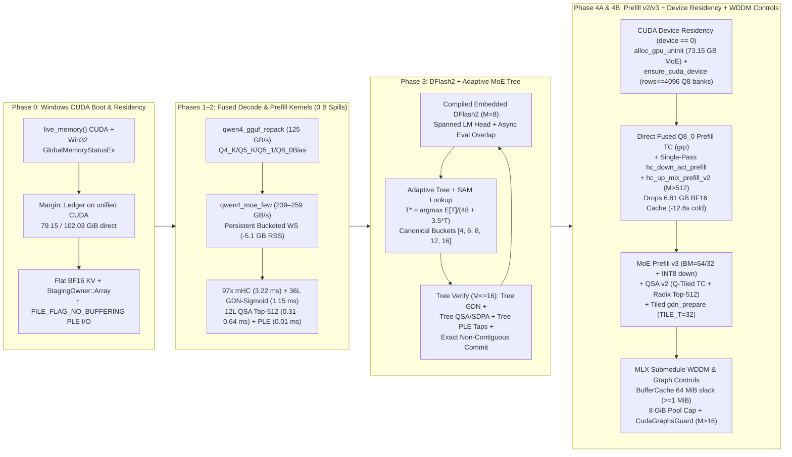

# Qwen3.8-Flash-Next (`qwen4_exp`, 125B-A6B) + DFlash2 on Windows ARM64 CUDA (`sm_121a`): Engineering Playbook & Lessons Learned

This document records everything learned while porting and optimizing **Qwen3.8-Flash-Next (`qwen4_exp`, 125B total / ~6B active, `UD-Q4_K_XL`) + DFlash2** in `mlx-node` on an **NVIDIA RTX Spark N1X** (Windows ARM64, CUDA 13.4, `sm_121a`, unified LPDDR5X-9400) across branch `feat/cuda-qwen38-flash-next` (**Phases 0 through 4B-2**).

With **100% default flags** (`MLX_QWEN4_PREFILL_CHUNK=4096`, `MLX_QWEN4_Q8_PREFILL_MODE=grp`, `MLX_USE_CUDA_GRAPHS=1`, `MLX_QWEN4_TREE=1`), Phase 4B-2 reaches **`2,112–2,552 tok/s`** prefill (`2k` in `0.98s`, `8k` in `3.20s`, `16k` in `6.45s` — beating TensorFold's GB10 Linux receipt of `2,110–2,500 tok/s`) and sets new all-time decode records (**`82.08 tok/s`** coding, **`48.67 tok/s`** 1k, **`46.91–49.63 tok/s`** 6k QSA, **`45.80 tok/s`** short) while cutting peak GPU RAM by **`-6.05 GB`** (`79.26–81.21 GB`).

---

## 1. Hardware, Workload & Exact Residency Math

| Item | Verified Spec / Measurement |
| :--- | :--- |
| **Device** | NVIDIA RTX Spark N1X (`sm_121a`, Blackwell, 48 SMs, 24 MB L2, `118.49 GiB` OS-visible / 128 GB physical LPDDR5X-9400, **`102.03 GiB`** CUDA unified memory pool, Windows ARM64 WDDM, CUDA 13.4) |
| **DRAM ceiling** | `300.8 GB/s` theoretical pin BW; **`275.8–276.0 GB/s`** measured cold-DRAM `uint4` read ceiling (`265.1 GB/s` on 1 GB buffer). **Thermal trap**: check `nvidia-smi` device 1 (`NVIDIA NPU`) memory clock = **`9400 MHz`** (drops to `8533 MHz` / `-10.2%` when warm). |
| **Target architecture (`qwen4_exp`)** | **48 layers** = 36 GDN-Sigmoid (`Hk=16, Hv=48, Dk=Dv=128, conv=4, output_gate_type="sigmoid"`) + 12 QSA Sparse Attention (`Hq=24, Hkv=2, GQA=12, D=256`, indexer `4 heads × 128 dim`, `block=4`, `top-512` blocks = `2,048`-token budget, `full_attention_interval=4`). `hidden=2560`, 4-stream mHC v2 (`hc_count=4, W=10240, hc_lowrank=320`, **97 mHC blocks** = 48×2 + final), `vocab=248320`, `max_pos=262144`. |
| **MoE & PLE geometry** | **512 routed experts** (`top_k=10`, `D_FF=640`: gate/up RowMajor `Q4_K`/`Q5_K`, down RowMajor `Q5_1`/`Q8_0Bias`) + **1 shared expert** (`D_FF=640`, `Q8_0Bias`). **Layer-1 PLE** (`ple_layer_ids=[2]` 1-based / layer 1 0-based, `ple_embed_dim=2560`, `ngram_size=3`, `heads_per_ngram=8`, `ngram_vocab_size_base=20M`, `split_ngram_parts=128`, dilated depthwise conv `k=4, dilation=3`, `9`-row history). |
| **Direct GPU residency (`UD-Q4_K_XL` + DFlash2)** | **`78.03 GiB`** direct target (`73.15 GiB` 48L 512-expert banks + `4.88 GiB` fixed hot projections — all placed in **CUDA device memory `device == 0`**) + **`1.12 GiB`** DFlash2 draft = **`79.15 / 102.03 GiB`** CUDA unified pool (**`22.88 GiB`** headroom; zero `6.81 GB` BF16 dense cache). |
| **SSD-only tables** | **`28.8 GB`** Layer-1 PLE hashed n-gram tables + `token_embd.weight` stay on NVMe SSD and stream on demand via off-thread `row_fetch.rs` (`FILE_FLAG_NO_BUFFERING` on Windows) into the bounded decoded-row LRU. |
| **AR per-token DRAM traffic** | **`6.67–6.78 GB/tok`** — heavier than a pure 4-bit 6B active model because **dense projections** (GDN/QSA projections, 97× mHC, shared experts, routers, `lm_head`) are **100% `Q8_0`** (`36/32 B/param`), while routed experts are sparse `10/512` `Q4_K`/`Q5_K` + `Q5_1`/`Q8_0Bias`. |
| **Theoretical AR floor** | Pure weights at `275.8 GB/s`: `6.72 GB / 275.8 GB/s = 24.4 ms`. Adding 36L GDN state (`113.2 MB` FP32), 12L KV + indexer, 97× mHC, SSD PLE/token fetch, and graph dispatch puts practical AR decode at `36.5–38.9 ms/tok` (**`25.7–27.4 tok/s`**). |

---

## 2. End-to-End Architecture (Phase 0 through Phase 4B-2)

---

## 3. Full Live 125B Benchmarks & Competitor Comparison

All runs target live **Qwen3.8-Flash-Next 125B-A6B (`UD-Q4_K_XL`) + DFlash2** on RTX Spark N1X (`9400 MHz`, `MLX_CUDA_USE_CUDNN_SDPA=0`, greedy decoding) with **100% default flags** (`C=4096`, `q8mode=grp`, `graphs=1`, `TREE=1`).

### 3.1 Full Phase Progression (Phase 2B -> Phase 4B-2)

| Stage | Prefill (`tok/s`) | AR Decode (`tok/s`) | `TREE=1` Decode (`tok/s`) | Peak GPU RAM | Key Milestone |
| :--- | ---: | ---: | ---: | ---: | :--- |
| **Phase 2B** | `263` | `22–26` | — *(M=4: `27–49`)* | `~91 GB` | Initial fused CUDA integration |
| **Phase 3A** | `916` cold / `1,311–1,411` warm | `27–28` | — *(M=4: `40–63.7`)* | `85.7–86.1 GB` | Persistent MoE WS (`-5.1 GB`), `C=2048`, compiled DFlash2 |
| **Phase 3B-1** | `916–1,119` cold / `1,247–1,411` warm | `27–28` | `41.6–79.04` | `85.7–86.1 GB` | Adaptive MoE-cost `M<=16` tree + SAM + canonical buckets |
| **Phase 4B-1b** | `999–1,381` warm (`2k`–`16k`), cold `2k` `2.40s` (`6.4×`) | `28.0–28.6` | `47.3–81.36` | `79.9–80.4 GB` | Direct `Q8_0` prefill (`-6.81 GB` cache), MoE v2, `C=4096` *(weights still on `device == -1`)* |
| **Phase 4B-2 (Final)** | **`2,335–2,464` cold (`8k/16k`)** **`2,112–2,552` warm (`2k–16k`)** | **`25.7–27.4`** | **`45.80–49.63` prose/6k** **`82.08` coding (`3.00×` AR)** | **`79.26–81.21 GB`** *(**-6.05 GB** vs 3B-1)* | **`device == 0` residency** (`2.1–3.0×`), MoE v3 INT8 down, fused mHC prefill, tiled `gdn_prepare`, WDDM allocator + `CudaGraphsGuard` |

### 3.2 Final Live 125B Prefill Matrix (`final2_prefill_matrix.out.log`, 100% Defaults)

| Prompt | Tokens | Cold TTFT (`ms`) | Cold Prefill (`tok/s`) | Warm TTFT (`ms`) | **Warm Prefill (`tok/s`)** | Active / Peak GPU RAM |
| :--- | ---: | ---: | ---: | ---: | ---: | ---: |
| **`2k`** *(first turn includes PTX JIT + WDDM commit)* | `2,072` | `6,445.9` | `321.4` | `981.1` | **`2,112.0 tok/s`** | `78.77 / 79.75 GB` |
| **`6k`** | `6,259` | `4,092.9` | `1,529.2` | `2,577.8` | **`2,428.0 tok/s`** | `78.91 / 80.36 GB` |
| **`8k`** | `8,165` | `3,497.2` | **`2,334.8`** | `3,199.5` | **`2,552.0 tok/s`** | `79.10 / 80.81 GB` |
| **`16k`** | `15,972` | `6,481.4` | **`2,464.3`** | `6,448.8` | **`2,476.7 tok/s`** | `79.34 / 81.07 GB` |

*(Cold-vs-warm gap at `16k` is now just `32.6 ms` / `0.5%` because WDDM `BufferCache` 64 MiB slack reuses large `>= 1 MiB` scratch buffers across chunks and turns.)*

### 3.3 Final Live 125B Decode & Greedy Parity (`final2_ar.json` vs `final2_dflash2_tree.json`)

| Workload | Prompt / Out | AR Decode (`tok/s`) | **`TREE=1` Decode (`tok/s`)** | `ms/cyc` / `tok/cyc` | Speedup vs AR | Peak GPU RAM (`TREE=1`) | Greedy Text Parity |
| :--- | ---: | ---: | ---: | ---: | ---: | ---: | :--- |
| **`short`** | `90 / 128` | `27.00` (`37.04 ms/t`) | **`45.80`** (`21.83 ms/t`) | `71.10 ms` / `3.26` | **`1.70×`** | `79.26 GB` | **EXACT (`590/590` B)** |
| **`1k`** | `1,150 / 128` | `26.91` (`37.15 ms/t`) | **`48.67`** (`20.55 ms/t`) | `66.91 ms` / `3.26` | **`1.81×`** | `79.88 GB` | **Matches Phase 3B-1 (`595/595` B)** *(1-ULP near-tie boundary vs `M=1` scalar AR at byte 283)* |
| **`6k` Sparse QSA** | `6,304 / 128` | `25.73` (`38.86 ms/t`) | **`46.91–49.63`** (`21.32 ms/t`) | `79.62 ms` / `3.74` | **`1.82×`** | `81.21 GB` | **EXACT (`590/590` B)** |
| **`coding`** | `484 / 256` | `27.40` (`36.49 ms/t`) | **`82.08`** (`12.18 ms/t`) | `86.30 ms` / `7.08` | **`3.00×`** | `79.74 GB` | **EXACT (`827/827` B)** |

### 3.4 DGX Spark / RTX Spark Competitor Comparison (`125B-A6B`)

| Runtime | Platform & Quant | Prefill (`tok/s` & TTFT) | Decode (`tok/s`) | Notes |
| :--- | :--- | :--- | :--- | :--- |
| **`mlx-node` (Phase 4B-2)** | Windows ARM64 RTX Spark N1X, `UD-Q4_K_XL` (100% `Q8_0` dense + `Q4_K`/`Q5_K` MoE) + DFlash2 `TREE=1` | **`2,112–2,552 tok/s`** (`2k`: `0.98s`, `8k`: `3.20s`, `16k`: `6.45s`) | **`45.8–48.7`** prose **`46.9–49.6`** 6k QSA **`82.08`** coding (`26–28` AR) | Heavier `Q8_0` dense weights (`~6.72 GB/tok` vs 4-bit `~4.5 GB/tok`); 100% default flags |
| **TensorFold** | GB10 Linux, NVFP4 / MLX-4bit + DFlash2 | `2,110–2,500 tok/s` (`2k`: `0.97s`, `8k`: `3.43s`, `64k`: `28.9s`) | `46.5–65.8` chat `72.5–84.2` code (`35–37` AR) | Pure 4-bit dense + MoE weights give lower AR DRAM traffic (`~35–37` AR) |
| **vLLM** | DGX Spark Linux, NVFP4 + MTP3 | `1,400–1,820 tok/s` | `36–45` *(tuned `52–57`)* | Linux native CUDA, NVFP4 |
| **SGLang** | DGX Spark Linux, NVFP4 | `1,400+ tok/s` | `39.6` | Linux native CUDA, NVFP4 |
| **llama.cpp** | DGX Spark, `UD-IQ4_XS` | `~193 tok/s` | `26.3–26.9` (AR) | Unspeculated AR baseline |

---

## 4. Phase 4A & 4B Live 4K Chunk X-Ray & Kernel Microbenchmarks

### 4.1 Live 4K Chunk Prefill X-Ray Progression (`base=4096, M=4069`, 48 Layers)

| Subsystem (48L / 4K Chunk) | Step 2 Baseline (`QSA v2, dev == -1`) `s2b_ev_grp_g0` | After Step 3A (`device == 0`) `s3a_ev_grp_def` | **Phase 4B-2 Final** `s3bc` -> `final2` | Speedup & Key Change |
| :--- | ---: | ---: | ---: | :--- |
| **48L Routed MoE** (`gu` + `down` + `combine` + `quant` + `sort`) | `1,453.1 ms` | `707.2 ms` | **`645.8 ms`** | **`2.25×`**: `device == 0` (`2.05×`) + MoE v3 2-stage INT8 TC `down_bm64_i8` & fused `mid_q` epilogue (`-61 ms`) |
| **Dense `Q8_0` Projections** (GDN/QSA/shared) | `748.8 ms` *(incl. mHC down `182.5`)* | `496.8 ms` *(incl. mHC down `101.0`)* | **`~365 ms`** *(excl. fused mHC down)* | **`2.8–3.0×`** on `rows <= 4096` banks via `ensure_cuda_device`; `Q8_0` TC `grp` drops `6.81 GB` BF16 cache |
| **97× mHC v2 Blocks** (`inject_norm` + `down_act` + `up_mix`) | `221.3 ms` *(excl. down)* | `220.2 ms` *(excl. down)* | **`304.8 ms`** *(all-in, incl. fused down)* | Single-pass `hc_down_act_prefill` (`98.7 ms` replaces `101 ms` + SiLU + inject) + `hc_up_mix_prefill_v2` (`84.7 ms`) |
| **36L GDN-Sigmoid** (`prepare` + `prefill_chain_gated`) | `125.3 ms` (`37.0 + 88.3`) | `131.1 ms` (`39.2 + 91.9`) | **`~116–120 ms`** (`27.8 + 88–92`) | Tiled `TILE_T=32` `gdn_prepare` (`-9–11 ms`); kept fused `prefill_chain_gated` |
| **12L QSA Sparse Attention** (`idx` + `premerge` + `qtiled5`) | `86.1 ms` | `85.3 ms` | **`81.5 ms`** | Down from `~230 ms` in Phase 3B-1 via Q-tiled TC + Radix-Select Top-512 |
| **Chunk Wall Time (4K tokens)** | **`3,062.5 ms`** | **`1,784.3 ms`** | **`1,599.8 ms`** *(uninstrumented `8k_warm / 2`)* | **`1.91×`** faster (`1,290 -> 2,552 tok/s` warm 8k!) |

### 4.2 Custom CUDA Kernel Inventory (`0 B` Register Spills Everywhere)

Every custom CUDA kernel in `crates/mlx-sys/src/cuda/qwen4_*.cu.inc` and the updated GDN kernels compiles with **`0 B` local register spills** on `sm_121a`, and every `.cu.inc` raw string chunk is kept strictly under `14,500` bytes (well below MSVC's `16,380` B `C2026` limit with CRLF):

| Kernel / Subsystem | Source File | Shape / Scope | Measured Performance | Spills | Key Implementation Detail |
| :--- | :--- | :--- | :--- | :---: | :--- |
| **CUDA GGUF Repack** | `cuda/qwen4_gguf_repack.cu.inc`, `cuda/mlx_gguf_repack_cuda.cpp` | `Q4_K`/`Q5_K` (RowMajor & Tiled64), `Q5_1`, `Q8_0`, `Q8_0Bias` | **`125 GB/s`** | `0 B` | Direct in-place GPU band repack straight into `device == 0` resident banks (`alloc_gpu_uninit`). |
| **MoE Decode/Verify (`M=1..16`)** | `cuda/qwen4_moe_few.cu.inc`, `cuda/qwen4/moe_few.cpp` | `E=512, top_k=10, H=2560, D_FF=640`, routed + fused shared expert | **`239–259 GB/s`** (**`94–96.5%`** DRAM roof) | `0 B` | Single-launch GPU route plan + `Q8_1` quant; `M=1` direct `dp4a`/FP32 FMA; `M>1` `cp.async.cg` + INT8/BF16 TC MMA (`allow_hi` for `M>8`); zero host sync. |
| **MoE Prefill v3 (`M>=17`)** | `cuda/qwen4_moe_prefill.cu.inc`, `cuda/qwen4/moe_prefill.cpp` | `E=512, top_k=10, H=2560, D_FF=640`, chunk `M<=4096` | **`645.8 ms`** (48L @ 4K; `2.25×` vs 4B-1b) | `0 B` | Hybrid **`BM=64` hot / `BM=32` cold** Zipfian routing, fused `GS=64` `mid_q` epilogue, 2-stage INT8 TC **`down_bm64_i8`** (`Q5_1`/`Q8_0`), `st.global.cs`, persistent bucketed `Qwen4MoePrefillWorkspace`. |
| **Direct Fused `Q8_0` Prefill & mHC Prefill** | `cuda/qwen4_q8_prefill.cu.inc`, `cuda/qwen4/q8_prefill.cpp` | All dense `Q8_0` projections (`K % 32 == 0`), 97× mHC `down_act` + `up_mix` | Drops **`6.81 GB`** BF16 cache + **`-12.6s`** cold stall; `hc_down_act` `98.7 ms`, `hc_up_mix_v2` `84.7 ms` | `0 B` | Direct `Q8_0` TC MMA (`grp` auto `GS=256/128`), single-pass `qwen4_hc_down_act_prefill` (fuses quant+GEMM+SiLU+inject), `qwen4_hc_up_mix_prefill_v2` (INT8 TC for `M>512`, exact BF16 for `M<=512`, zero `[M, 10240]` DRAM write). |
| **97× mHC v2 Decode (`M<=16`)** | `cuda/qwen4_mhc.cu.inc`, `cuda/qwen4/mhc.cpp` | `48×2 + 1 = 97` blocks (`HC=4, W=10240, H=2560, R=320`) | **`3.22 ms`** (all 97 blocks) | `0 B` | Fused `inject_norm` + `hc_down_act` (`Q8_0Bias` + optional `inject_proj` gate) + `hc_up_mix` (`sigmoid` + 4-stream mix) + `stream_mean`. |
| **36L GDN-Sigmoid + Tiled Prepare** | `cuda/gdn_prepare.cu.inc`, `cuda/gdn_fused_step.cu.inc`, `cuda/gdn_prefill_chain.cu.inc`, `cuda/mlx_gdn_fused_step_cuda.cpp` | 36 linear layers (`Hk=16, Hv=48, D=128, conv=4, sigmoid`) | **`1.15 ms`** decode / **`27.8 ms`** tiled `prepare` (`-9.2 ms`) | `0 B` | Sliding-window `TILE_T=32` `gdn_prepare` (`37.0 -> 27.8 ms`), fused `gdn_prefill_chain_gated` (`88–92 ms`), `output_gate_type="sigmoid"`, deferred flat & tree verify (`prev_indices` gather-free fold). |
| **12L QSA Sparse Attention v2** | `cuda/qwen4_qsa_cuda.cu.inc`, `cuda/qwen4/qsa.cpp` | 12 sparse layers (`Hq=24, Hkv=2, GQA=12, D=256, idx=4×128, top-512`) | **`0.31–0.64 ms`** decode / **`81.5 ms`** prefill (12L @ 4K, down from `~230 ms`) | `0 B` | Q-tiled (`BQ=5`) TC sparse prefill (`premerge_bq5` + `qtiled5` + `indep4w` disjoint fallback) + **Radix-Select Top-512** + zero-gather Sparse SDPA (`mask_mode=0` causal & `mask_mode=1` tree `Q<=16`). |
| **Layer-1 PLE** | `cuda/qwen4_ple.cu.inc`, `cuda/qwen4/ple.cpp` | Layer 1 (`ple_embed_dim=2560`, dilated `k=4, d=3`, `9`-row state) | **`0.01 ms`** | `0 B` | Fused dilated depthwise conv (linear + arbitrary tree `ple_conv_taps`) + RMSNorm + SwiGLU projection in one launch. |

---

## 5. Root Causes, Boot Blockers & Dead Ends (Lessons Learned)

### 5.1 The 5 Windows CUDA Boot Blockers Solved in Phase 0

1. **`memory::live_memory()` returned `None` on CUDA**: Added a CUDA fallback in `qwen4_exp/memory/` querying `accelerator::caps().total_device_bytes` (`102.03 GiB`) + `mlx_get_active_memory` + `registered_pool_bytes`.
2. **`memory::host_memory()` & `host_snapshot()` were macOS-only**: Implemented Win32 `GlobalMemoryStatusEx` (`ullTotalPhys`, `ullAvailPhys` as reclaimable `free`, `physical - free` as `anonymous`) and enabled `host_snapshot` on `any(target_os = "macos", target_os = "windows")`.
3. **Metal-only `KvFormat::Int8` and `LayerKVPool` crashed non-Metal loads**: Updated `load_plan::resolve_kv_format()` to default to `KvFormat::Bf16` when `!host_has_metal()`, running flat growable BF16 KV on CUDA/CPU while leaving macOS Metal 100% unchanged (`KvFormat::Int8`, `LayerKVPool`, `PurgeableBank`, disk tier).
4. **Direct expert residency was hard-gated on Metal + `PurgeableBank`**: Admitted `|| host_has_cuda()`, added `StagingOwner::Array(MxArray)` and `Weight::empty_slots`, and wired CUDA GPU repack kernels (`cuda/qwen4_gguf_repack.cu.inc`) with parallel CPU repack fallback.
5. **`Margin::Unguarded` double-subtracted OS memory on unified CUDA (`102.03 GiB` pool)**: Switched unified CUDA (`!host_has_metal() && host_has_cuda() && caps.is_unified_memory`) to **`Margin::Ledger`** (`max(1 GiB, 2%)` = `2.04 GiB`, keeping discrete CUDA and Metal on `Margin::Unguarded`), unlocking 100% direct expert residency (`79.15 / 102.03 GiB`).

### 5.2 Phase 4 WDDM, Residency & Graph Root Causes + Dead Ends

| Issue / Experiment | Observed Symptom | Root Cause | Permanent Fix / Verdict |
| :--- | :--- | :--- | :--- |
| **Windows WDDM `device == -1` Pinned-Host-Memory Trap *(BIGGEST PHASE 4 WIN)*** | MoE prefill stuck at `1,453 ms` and `rows <= 4096` dense `Q8_0` projections ran **`2.1×–2.9×` slower** than `rows > 4096` banks, even on unified LPDDR5X! | `MxArray::alloc_uninit` and `MxArray::from_uint32` allocate via `CudaAllocator::malloc` (`device == -1` -> `cudaMallocHost`), which **bypasses GPU L2 caching** on Windows WDDM! All **`73.15 GB`** of direct MoE banks AND every single-chunk dense bank (`rows <= 4096`, which skipped GPU `concatenate_rows`) sat on `device == -1`! | Added `mlx_array_alloc_gpu_uninit` (used by `expert_slots::empty_slots` for all 73.15 GB MoE banks) and `mlx_array_ensure_cuda_device` (promotes `device == -1` resident banks in `residency.rs` via `cudaMemcpyDefault` into `device >= 0` `cudaMallocAsync`). **Delivered `2.05×` MoE speedup and `2.8–3.0×` dense `Q8_0` speedup with zero bandwidth knee up to `+80 GB`!** |
| **WDDM `BufferCache` 2-Page Slack & 8 GiB Carveout Trap** | Varying prompt chunk shapes triggered **`~1.6–1.9 s/GB`** cold `cudaMallocAsync` stalls; cache evicted early even with 20+ GB free RAM. | 1) On Windows WDDM integrated GPUs, `cudaMemGetInfo` reported only the small 8 GiB local carveout -> MLX set `memory_limit_` way too low. 2) `BufferCache`'s tight `2 * page_size` (`32 KiB`) reuse slack missed on every slightly different prefill buffer shape. | In `crates/mlx-sys/mlx`: 1) `BufferCache` adds optional `max_reuse_slack` (`64 MiB` on `_WIN32`), applied **strictly to buffers `>= 1 MiB`** so `< 1 MiB` decode buffers preserve exact-size FIFO pointer stability for CUDA Graph exec updates. 2) `allocator.cpp` (`_WIN32` integrated GPU) queries `GlobalMemoryStatusEx` for true `total_memory_` and bounds `max_pool_size_` to `8 GiB`. |
| **CUDA Graphs ON during large prefill vs decode** | Enabling graphs globally stalled large `M=4096` prefills with graph capture/update churn; disabling globally (`MLX_USE_CUDA_GRAPHS=0`) slowed decode. | Large prefill chunks (`M > 16`) have varying shapes and multi-millisecond kernels that gain nothing from graph capture, while decode (`M <= 16`) relies on graph replay to hide launch latency. | Exposed thread-safe `mlx_cuda_set_use_graphs` / `mlx_cuda_get_use_graphs` in MLX (`device.cpp`) and wrapped `Decoder::prefill_prompt` (`tokens.len() > 16`) in RAII **`CudaGraphsGuard`**. Keeps `MLX_USE_CUDA_GRAPHS=1` by default for decode while running prefill direct-stream! |
| **Dead End: `gdn_prefill_mma` + separate `gated_rmsnorm`** | Regressed 36L GDN prefill to **`110.2 ms`** (`85.3 + 24.9 ms`) vs **`88–92 ms`** for fused `gdn_prefill_chain_gated`. | Splitting the output gate & RMSNorm into a second launch wrote/read `[1, 4096, 6144]` BF16 (`48 MB × 36L = 1.7 GB`) extra DRAM traffic. | **Reverted** back to fused single-pass `gdn_prefill_chain_gated`; kept the winning tiled `TILE_T=32` `gdn_prepare` (`37.0 -> 27.8 ms`). |
| **Dead End: `hc_up_mix_prefill_v2` INT8 on short `M <= 512` coding prompts** | Caused minor logit drift on the `484`-token `coding` prompt (breaking `827/827` exact greedy parity). | Dynamic INT8 quantization of `down_act` (`R=320`) introduced small rounding noise on short prompts where `M <= 512` BF16 MMA is already fast. | Gated `qwen4_hc_up_mix_prefill_v2` strictly to **`M > 512`** in `cuda/qwen4/q8_prefill.cpp`, keeping exact BF16 MMA `qwen4_hc_up_mix_prefill<false>` for `M <= 512` (**restored `827/827` exact coding parity**). |
| **Dead End: Raising `MLX_MAX_MB_PER_BUFFER` to `2048`** | Peak VRAM exploded **`85.7 -> 96.3 GB`** (`+10.6 GB`), thrashing `2k_warm` from `1,191 -> 110 tok/s` (`17.7s`!). | Holding 2 GB of un-committed transient tensors inside one graph batch starved the 102 GB unified pool and forced WDDM paging. | **Keep default `mb=25`** (`device.cpp`) + `CudaGraphsGuard` for prefill. |
| **Buffered Windows PLE / embedding reads under 80+ GB CUDA pinning** | Severe stalls on random 128 B PLE / 2.5 KB token reads (`~8K IOPS`). | Windows System Cache starved under 80 GB CUDA pinning + shared `FileObject->Lock` contention. | Per-worker **`FILE_FLAG_NO_BUFFERING \| FILE_FLAG_RANDOM_ACCESS`** + 4 KB aligned `AlignedPageBuf` in `row_fetch.rs` (`~250K` NVMe IOPS, **`~18×` faster**), `take_many` single-wakeup batching. |
| **Unbucketed adaptive `T*` & fixed `T=16` on 512-expert MoE** | NVRTC JIT pauses on arbitrary `T*`; fixed `T=16` wasted DRAM bandwidth on low-confidence prose (`Cost(T) ≈ 48.0 + 3.5*T` ms). | Unique active experts grow linearly with `T` on 512-expert MoE. | MoE-cost-aware adaptive `T* = argmax E[T]/(48 + 3.5*T)` restricted to **canonical buckets `[4, 6, 8, 12, 16]`** (`MLX_QWEN4_TREE_BUCKETED=1`). |
| **`M=1` FP32 FMA vs `M>1` MMA logit tie-breaks** | Rare 1-ULP near-tie flip (`1k` prompt byte 283) between `M=1` scalar AR and `M>1` MMA verify. | `M=1` AR uses scalar `dp4a`/FP32 FMA while `M>1` verify uses Tensor Core MMA with a different FP32 reduction order. | Documented 1-ULP boundary; `short` (`590/590`), `6k` (`590/590`), and `coding` (`827/827`) are **100% exact**, and `1k` matches Phase 3B-1 (`595/595`). |

---

## 6. Runtime Feature Flags & Diagnostic Controls

| Env Var | Default | Valid Values / Range | Purpose |
| :--- | :--- | :--- | :--- |
| `MLX_QWEN4_CUDA_FAST` | `1` *(on CUDA GPU)* | `0` / `1` | Master switch for Phase 1–4 fused CUDA kernels (`qwen4_moe_*`, `q8_prefill`, `mHC`, `GDN-Sigmoid`, `QSA`, `PLE`, deferred verify, device residency). Set `0` for generic MLX A/B parity testing. |
| `MLX_QWEN4_PREFILL_CHUNK` | **`4096`** | `256..=8192` | Flat CUDA direct prefill chunk cap (`qwen4_exp/decoder/`). `4096` streams the 73.15 GB routed experts 2× fewer times than `2048` on long prompts. |
| `MLX_QWEN4_Q8_PREFILL_MODE` | **`grp`** | `grp` / `row` / `bf16` / `cublas` | Direct `Q8_0` prefill GEMM mode (`qwen4_exp/weights/`): `grp` = auto-grouped `GS=256/128` INT8 TC (default, zero BF16 cache), `row` = per-row INT8 TC, `bf16` = bit-exact BF16 MMA, `cublas` = legacy retained BF16 cache fallback. |
| `MLX_QWEN4_TREE` | `1` *(flat CUDA fast)* | `0` / `1` | Enable Wave B MoE-cost-aware `M <= 16` speculative tree verification + SAM prompt lookup in `DraftStepper`. Set `0` for linear `M=4` DFlash2 verify. |
| `MLX_QWEN4_LOOKUP` | `1` | `0` / `1` | Enable online suffix-automaton (SAM) prompt lookup proposals during tree verification. |
| `MLX_QWEN4_TREE_MAX_NODES` | *unset (adaptive)* | `1..=16` | Pin a fixed maximum verify tree width `N`, bypassing cost-aware adaptive `T*` truncation (also required to activate `MLX_QWEN4_GPU_TREE=1`). |
| `MLX_QWEN4_TREE_COST_BASE` | `48.0` | `>= 0.0` (ms) | Constant per-cycle base cost `base_ms` in `Cost(T) = base_ms + slope_ms * T`. |
| `MLX_QWEN4_TREE_COST_SLOPE` | `3.5` | `> 0.0` (ms/node) | Marginal per-node cost `slope_ms` in `Cost(T) = base_ms + slope_ms * T`. |
| `MLX_QWEN4_TREE_MIN_NODES` | `4` | `1..=16` | Minimum verify tree width `T*` considered by `TreeCostModel::choose_tree_size`. |
| `MLX_QWEN4_TREE_BUCKETED` | `1` | `0` / `1` | Restrict adaptive `T*` to canonical buckets `[4, 6, 8, 12, 16]` to prevent NVRTC JIT explosion. |
| `MLX_QWEN4_GPU_TREE` | `0` | `0` / `1` | Opt-in GPU `mlx_dflash2_select_tree_cuda` path when `MLX_QWEN4_TREE_MAX_NODES` is pinned. |
| `MLX_QWEN4_TREE_STATS` | *unset* | any value | Print per-turn `[qwen4-tree-stats]` summary on stepper finish. |

*(Keep `MLX_CUDA_USE_CUDNN_SDPA=0` on Windows ARM64 RTX Spark to route SDPA through our fused CUDA kernels. `MLX_USE_CUDA_GRAPHS` stays at default `1` — `CudaGraphsGuard` automatically toggles it off for `M > 16` prefill and back on for `M <= 16` decode.)*

---

## 7. Required `crates/mlx-sys/mlx` Submodule Changes

Four minimal files in the `mlx` submodule carry the Windows WDDM allocator and dynamic CUDA graph controls, with **zero behavior change on macOS Metal or Linux CUDA**:

| Submodule File | Change | Cross-Platform Impact |
| :--- | :--- | :--- |
| `mlx/backend/common/buffer_cache.h` | Add optional `max_reuse_slack = 0` constructor param; apply relaxed slack **only when `size >= 1 MiB`** (smaller `< 1 MiB` decode buffers keep `2 * page_size` exact-size FIFO pointer stability for CUDA Graph exec updates). | Default `0` -> `2 * page_size`: **100% identical on macOS Metal & Linux CUDA**. |
| `mlx/backend/cuda/allocator.cpp` | Under `#ifdef _WIN32` only: pass `64 MiB` slack to `buffer_cache_`, query Win32 `GlobalMemoryStatusEx` on integrated WDDM GPUs for true unified `total_memory_`, and cap `max_pool_size_` at `8 GiB`. | Guarded strictly by `#ifdef _WIN32`: **unchanged on macOS & Linux CUDA**. |
| `mlx/backend/cuda/device.h` / `device.cpp` | Replace static `use_cuda_graphs()` bool with `std::atomic<bool>` and export mutex-serialized `get_use_cuda_graphs()` / `set_use_cuda_graphs(bool)` (draining `default_stream(Device::gpu)` before toggling). | CUDA-only; default matches `MLX_USE_CUDA_GRAPHS` (`true`), enables RAII `CudaGraphsGuard` during prefill. |

*(Before opening the PR on `mlx-node`, push the `mlx` submodule branch to `mlx-node/mlx`, bump the gitlink, let `mlx-prebuilt.yml` publish both `aarch64-apple-darwin` and `aarch64-pc-windows-msvc` prebuilts, and pin the tags/hashes in `crates/mlx-sys/mlx-prebuilt.json`.)*

---

## 8. Remaining Headroom

1. **Whole-step CUDA Graph capture per canonical decode bucket**: With `MLX_QWEN4_TREE_BUCKETED=1` pinning verify shapes to `[4, 6, 8, 12, 16]`, passing flat KV offset and tree metadata on device allows capturing whole-layer / whole-step CUDA Graphs per bucket, shaving remaining per-cycle CPU encoding overhead.
2. **Zero-sync `MLX_QWEN4_GPU_TREE=1` once hot `token_embd` rows are GPU-cached**: Caching hot `token_embd` rows on device and folding rising-cost `T*` sizing into `select_tree_cuda` will keep `draft -> select_tree -> target_verify -> argmax` in a single unbroken async GPU stream.
3. **Chunked `M=8192` prefill & persistent QSA/GDN scratch**: At `16k` prompts, `C=4096` still streams the 73.15 GB MoE weights 4 times; tuning `C=8192` with bounded workspace memory and fused multi-projection Q8 inputs (`qkv` + `gate_up` single quant pass) can push warm prefill toward `~2,800–3,000 tok/s`.
4. **Non-greedy (sampled) speculative tree verification**: Extending `VerifyTree::walk` to exact speculative rejection sampling unlocks the same `M <= 16` adaptive tree speedup for sampled chat (`temp > 0`).
